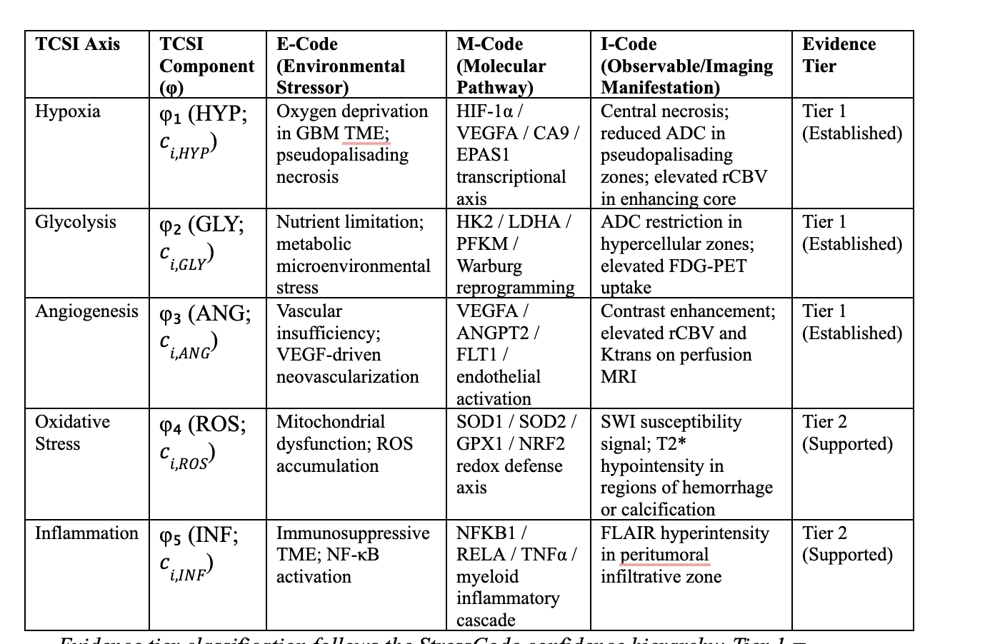

# StressCode

**Author:** Naija Thomas  
**Framework:** StressCode  
**Status:** Early-stage prototype / ontology-informed annotation framework  

---

## Overview

StressCode is an early-stage, ontology-informed annotation framework designed to make shared biomedical research data easier to connect, interpret, and reuse across datasets, disease areas, and data types.

Many public biomedical datasets include information related to stressors, biological responses, observable phenotypes, interventions, and outcomes. However, these elements are often stored separately by file format, discipline, or data modality rather than organized by the biological or contextual processes they represent.

StressCode addresses this gap by adding a lightweight semantic annotation layer to existing datasets. The framework helps users connect multimodal research data through shared stress-response concepts without requiring them to redesign existing data infrastructure.

The initial proof-of-concept focuses on cancer data, with glioblastoma as the first use case.

---

## What StressCode Is: A Three-Part Informational Coding System

StressCode is a three-part informational coding system that connects environmental stress contexts, molecular stress-response pathways, and imaging-visible manifestations into one reusable annotation structure.

The three parts are:

```
Environment Code → Molecular Code → Imaging Code
```

Together, these three code layers allow users to describe how a stressor or environmental context may be associated with a biological stress-response pathway and how that pathway may appear as an imaging-visible feature in a specific anatomical or tumor location.

### 1. Environment Code
The Environment Code identifies the stressor or contextual environment that may influence the biological system. This may include the tumor microenvironment, tissue environment, treatment environment, cellular environment, physiological environment, or broader external environment.

Examples include hypoxia, inflammation, oxidative stress, radiation exposure, acidosis, nutrient deprivation, immune suppression, environmental toxin exposure, and chronic psychosocial stress.

### 2. Molecular Code
The Molecular Code identifies the molecular or biological stress-response pathway associated with the Environment Code.

Examples include HIF-1α signaling, VEGF angiogenesis, DNA damage response, NF-κB inflammatory signaling, oxidative stress response, PI3K/AKT/mTOR signaling, p53 signaling, unfolded protein response, TGF-beta signaling, and immune checkpoint signaling.

### 3. Imaging Code
The Imaging Code identifies the imaging-visible phenotype associated with the Molecular Code and maps that phenotype to a specific image location.

Examples include central necrosis in the tumor core, elevated rCBV in the enhancing tumor region, FLAIR hyperintensity in the peritumoral region, diffusion restriction in hypercellular tumor regions, ring enhancement along the tumor margin, or PET signal in a hypoxic region.

A complete StressCode annotation is represented as:

```
Environment Code + Molecular Code + Imaging Code = StressCode Annotation
```

**Example:**  
Hypoxic tumor microenvironment → HIF-1α/VEGF signaling → central necrosis and elevated rCBV in tumor core

---

## Purpose

The purpose of StressCode is to improve the interpretation, interoperability, and reuse of shared biomedical research data.

StressCode is designed to help researchers, clinicians, trainees, data stewards, and under-resourced institutions:

- Connect biological mechanisms across molecular, imaging, treatment, and clinical outcome data.
- Annotate datasets using a simple stress-response relationship model.
- Improve secondary reuse of public research datasets.
- Support cross-disciplinary hypothesis generation.
- Make dataset context and evidence confidence more transparent.
- Lower barriers to multimodal data interpretation.

---

## Conceptual Model

StressCode organizes disease research data into a four-tier directional cascade:

```
Stressor → Molecular or System-Level Response → Observable Phenotype → Outcome
```

### 1. Stressor
A biological, environmental, social, physiological, microenvironmental, or treatment-related pressure acting on a system, tissue, tumor, organ, or patient.

Examples: Hypoxia, Oxidative stress, Inflammation, Radiation-induced stress, Metabolic stress, Social or environmental stressors.

### 2. Molecular or System-Level Response
A biological pathway, process, or system-level response activated, inhibited, or altered by a stressor.

Examples: HIF-1/VEGF signaling, DNA damage response, Immune activation, Inflammatory signaling, Angiogenesis, Metabolic adaptation.

### 3. Observable Phenotype
A measurable manifestation of stress-response biology.

Examples: Imaging-visible features, Clinical signs, Behavioral features, Physiological measurements, Histologic findings, Laboratory values, Radiomic features.

### 4. Outcome
A measurable indicator of intervention response, disease progression, patient health, or functional status.

Examples: Treatment response, Recurrence, Progression, Survival, Functional decline, Symptom burden, Therapy resistance.

### Relationship Predicates

StressCode uses standardized relationship predicates to describe how concepts are connected across levels:

`triggers` · `activates` · `induces` · `modulates` · `manifests_as` · `associated_with` · `predicts` · `leads_to`

These predicates support consistent annotation while preserving the distinction between established mechanisms and exploratory associations.

---

## Evidence Confidence Tiers

StressCode assigns each relationship an evidence confidence tier. This prevents all links from being treated as equally certain.

| Evidence Tier | Definition | Example Evidence |
|---|---|---|
| **Tier 1: Established** | Well-supported by consensus literature, established molecular mechanisms, validated clinical criteria, or formal biomedical ontologies. | Standard diagnostic criteria, validated biomarkers, established molecular pathways |
| **Tier 2: Supported** | Supported by robust preclinical models, multi-institutional retrospective studies, or multiple converging correlation studies. | Repeated observational findings, strong retrospective radiogenomic associations |
| **Tier 3: Hypothesis-Generating** | Biologically plausible; supported by pilot studies, exploratory secondary data, or emerging evidence requiring further validation. | Early-stage associations, exploratory links, preclinical observations not yet validated |

---

## Initial Use Case: Glioblastoma

Glioblastoma is the first demonstration use case for StressCode. It includes several stress-response mechanisms that can be linked across molecular, imaging, and biological outcome data.

The five TCSI axes applied in the GBM use case are shown in the table below.



*Figure 1. The five TCSI axes with their E-Code (environmental stressor), M-Code (molecular pathway), I-Code (imaging manifestation), and evidence tier assignments. Evidence tier classification follows the StressCode confidence hierarchy.*

| Stressor | Molecular Pathway | Observable Phenotype | Evidence Tier |
|---|---|---|---|
| Severe hypoxia | HIF-1/VEGF cascade | Elevated rCBV / central necrosis | Tier 1: Established |
| Nutrient limitation | HK2/LDHA/Warburg reprogramming | ADC restriction; elevated FDG-PET | Tier 1: Established |
| Vascular insufficiency | VEGFA/ANGPT2/FLT1 | Contrast enhancement; elevated Ktrans | Tier 1: Established |
| Mitochondrial dysfunction | SOD1/SOD2/NRF2 redox axis | SWI susceptibility; T2* hypointensity | Tier 2: Supported |
| Immunosuppressive TME | NFKB1/RELA/TNFα cascade | FLAIR hyperintensity (peritumoral) | Tier 2: Supported |

---

## Installation

### Python environment

```bash
pip install -r requirements.txt
```

### Conda environment

```bash
conda env create -f environment.yml
conda activate stresscode
```

> **Note:** Replace versions in `requirements.txt` and `environment.yml` with your verified environment output (`pip freeze`, `conda env export --from-history`, and R `sessionInfo()`) before publishing.

---

## Repository Structure

```
stresscode/
│
├── README.md
├── LICENSE
├── CITATION.cff
│
├── data/
│   ├── tcga_gbm_reference.csv       # Frozen TCSI reference parameters (μ, σ; n=166)
│   └── stresscode_annotations_emi.csv   # E→M→I annotation table (five axes)
│
├── docs/
│   ├── framework_overview.md
│   ├── evidence_tiers.md
│   └── workflow.md
│
├── templates/
│   └── stresscode_annotation_template.csv
│
├── vocabularies/
│   └── stresscode_controlled_vocabulary.csv
│
├── schemas/
│   └── stresscode_relationship_schema.json
│
├── use_cases/
│   └── glioblastoma/
│       ├── gbm_demo_crosswalk.csv
│       └── gbm_example_annotations.csv
│
├── figures/
│   └── tcsi_axis_table.png          # TCSI five-axis annotation table (Figure 1)
│
└── requirements.txt
```

---

## Annotation Template

Recommended columns for a StressCode annotation file:

| Column Name | Description |
|---|---|
| `dataset_id` | Identifier for the dataset or collection |
| `subject_id` | De-identified subject, case, or sample identifier |
| `disease_area` | Disease area or condition |
| `stressor` | Stressor term |
| `molecular_or_system_response` | Pathway or biological/system-level response |
| `observable_phenotype` | Imaging, clinical, behavioral, histologic, or measurable phenotype |
| `outcome` | Clinical, treatment-response, progression, or functional outcome |
| `relationship_predicate` | Predicate describing the relationship |
| `evidence_tier` | Tier 1, Tier 2, or Tier 3 |
| `ontology_mapping` | Related ontology or standard term, if available |
| `source_reference` | Literature, dataset, or documentation source |
| `notes` | Optional notes |

---

## Equity and Responsible Data Reuse

StressCode is designed to support more equitable data reuse by lowering barriers to multimodal data interpretation.

Many public biomedical datasets are available but difficult to reuse without specialized computational expertise, dedicated data engineering support, or large interdisciplinary teams. StressCode provides low-barrier tools such as spreadsheet templates, visual maps, and standardized vocabularies to help more users participate in secondary data analysis.

The initial glioblastoma demonstration uses public TCGA/TCIA-linked data. These datasets are valuable for prototyping but may have limitations in racial, ethnic, ancestral, geographic, and socioeconomic representation. StressCode does not correct underlying cohort imbalance. Instead, it encourages explicit annotation of dataset context, cohort characteristics, evidence confidence, and applicability so that users can interpret findings responsibly.

---

## What StressCode Is Not

StressCode is not intended to replace:

- Existing biomedical ontologies
- Existing cancer data repositories
- Raw data standards
- DICOM, RadLex, Gene Ontology, NCI Thesaurus, or caDSR
- Expert biological or clinical interpretation
- Statistical validation
- Population-specific validation studies

StressCode is a lightweight semantic overlay that helps connect existing data through shared stress-response concepts.

---

## Intellectual Work and Attribution Notice

StressCode is original applicant-developed intellectual work created by Naija Thomas.

This repository documents the StressCode framework, including its conceptual model, terminology structure, relationship schema, evidence-tier system, workflow, and prototype use case.

You may use, share, or adapt this work only in accordance with the license selected for this repository. Proper attribution to the original author is required.

---

## Citation

If you use or adapt StressCode, please cite:

> Thomas, Naija. *StressCode: Making Shared Research Data Easier to Connect and Reuse*. GitHub repository. https://github.com/YOUR-USERNAME/YOUR-REPOSITORY-NAME

A `CITATION.cff` file is included for machine-readable citation.

---

## License

StressCode © 2026 by Naija Thomas is licensed under [Creative Commons Attribution-NonCommercial 4.0 International (CC BY-NC 4.0)](https://creativecommons.org/licenses/by-nc/4.0/).

You are free to share and adapt this work for noncommercial purposes, provided appropriate credit is given to the original author. Commercial use is not permitted without written permission.

---

## Contact

**Naija Thomas**  
Email: Nthomas24@mmc.edu  
Email: Naijathomas@gmail.com

---

## Disclaimer

StressCode is a research framework and prototype annotation resource. It is not a clinical decision-making tool, diagnostic system, treatment recommendation system, or substitute for expert clinical, biological, statistical, or ethical review.

No private patient information, restricted-access data, third-party proprietary material, or confidential commercial trade secrets are included in this repository.
